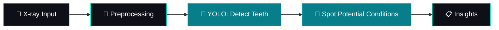

<div align="center">


<br/>


</div>

<br/>

## 🎮 Player Card

```text
╔══════════════════════════════════════════════════════════╗
║  PLAYER        Siddhant Wadher                           ║
║  CLASS         AI & Data Science Engineer (in training)  ║
║  GUILD         Ramdeobaba University  ·  Batch 2028      ║
║  MAIN QUEST    Dental AI  🦷  [ IN PROGRESS ]            ║
║  SIDE QUESTS   FastAPI · DSA in Java · LLMs & Agents     ║
║  SUPERPOWER    Turning messy data into working products  ║
╚══════════════════════════════════════════════════════════╝
```

## ⚡ What I'm About

I like the moment a pile of raw data turns into something that *does* something. I work across **data science, computer vision and full-stack development**, and I'm steering toward **AI engineering**: LLMs, agents, and shipping models as real applications.

|   | Right now |
|---|---|
| 🦷 **Building** | Dental AI, computer vision on dental X-rays |
| ⚙️ **Learning** | FastAPI and reliable backend design |
| 🧩 **Practising** | Data Structures & Algorithms in Java |
| 🎯 **Aiming at** | LLMs, AI agents, deploying intelligent apps |

<br/>

## 🧰 Inventory

<div align="center">

**`LANGUAGES`**


**`DATA · ML · VISION`**


<br/>


**`FRONTEND`**


**`BACKEND`**


**`DATABASES · TOOLS · CLOUD`**


</div>

<br/>

## 🚀 Main Quest: Dental AI 🦷

> *Can a model look at a dental X-ray and tell you what a dentist would notice?*



**Stack:** `Python` · `YOLO` · `PyTorch` · `OpenCV`

```text
Progress  ██████████░░░░░░░░░░  in development
```

<a href="https://github.com/SID-2006?tab=repositories">
  
</a>

<br/>

## 🗂️ Side Quests

<table>
<tr>
<td width="50%" valign="top">

### 📄 Scan-to-Excel
Drop in a scanned document, get structured data out.

`Python` `Flask` `React` `OCR`

</td>
<td width="50%" valign="top">

### ✈️ Flight Booking System
A database-driven booking app, from search to seat.

`Python` `MySQL`

</td>
</tr>
</table>

<br/>

## 🛣️ Roadmap

```text
[✓] Python · data analysis · ML foundations
[✓] Computer vision with YOLO & PyTorch (in use)
[~] FastAPI + backend systems
[~] DSA in Java
[ ] LLM-powered applications
[ ] AI agents
[ ] Deploy intelligent apps at scale
```

<br/>

## 📈 Stats

<p align="center">
  
  
</p>

<p align="center">
  
</p>

<p align="center">
  
</p>

<details>
<summary><b>🔓 <code>sudo cat secrets.txt</code></b></summary>
<br/>

- I trust a model more after I've tried to break it.
- Favourite debugging technique: explain the bug out loud until it fixes itself.
- Currently turning "it works on my machine" into "it works for everyone."

*(Edit these to your real ones, nothing beats a genuine easter egg.)*

</details>

<br/>

## 📡 Let's Connect

<p align="center">
  <a href="https://github.com/SID-2006"></a>
  <a href="https://www.linkedin.com/in/siddhant-wadher/"></a>
  <a href="mailto:siddhantwadher31@gmail.com"></a>
</p>

<p align="center"><code>LEARN → BUILD → EXPERIMENT → IMPROVE → REPEAT</code></p>


